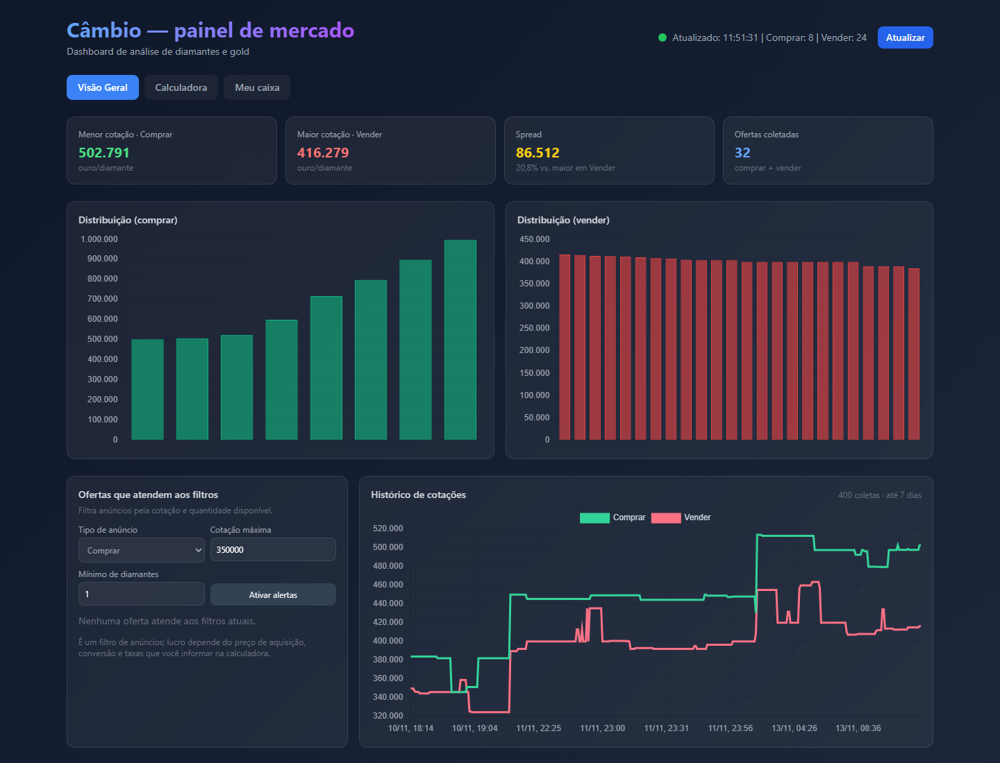

# Câmbio — painel de mercado local

Dashboard que acompanha cotações de um mercado de diamantes/gold, guarda o histórico, calcula o custo real do estoque por FIFO e exporta tudo em CSV.

Roda 100% na máquina: servidor HTTP em Python puro, sem dependências, sem banco externo, sem serviço na nuvem.



## O que o projeto faz

- **Coleta**: um userscript lê as ofertas na página e envia snapshots para o servidor local (`scripts/cambio-sync-local.user.js`).
- **Armazena**: o servidor grava o snapshot atual em JSON e o histórico resumido em outro arquivo.
- **Exibe**: o dashboard mostra melhores taxas, spread, distribuição das ofertas, filtros e gráfico do histórico.
- **Contabiliza**: a carteira controla compras de diamantes, vendas por gold, uso e conversão para reais, com consumo de estoque por FIFO.
- **Analisa**: um ETL carrega os JSON em SQLite e permite consultar custo por lote, resultado por venda e evolução do spread.
- **Exporta**: tabelas e visões em CSV prontos para abrir no Excel.

## Arquitetura

```
navegador (userscript)
        │  POST /dados
        ▼
servidor.py  (http.server, stdlib)
        │
        ├── cambio_dados.json      snapshot atual
        ├── cambio_historico.json  resumo por coleta (até 10.080 pontos)
        └── meu_caixa.json         lançamentos da carteira
                 │
                 ▼
        banco/etl.py  ──►  cambio.db (SQLite)
                 │
                 ├── banco/consultas.sql   consultas e visões
                 ├── banco/relatorio.py    relatório em texto
                 └── banco/exportar_csv.py saída para planilha

dashboard.html  ── GET /dados, /historico, /carteira
```

## Estrutura

```
cambio-local/
├── servidor.py              API local + arquivos estáticos
├── dashboard.html           interface (HTML/CSS/JS, sem framework)
├── iniciar.bat              atalho para o servidor no Windows
├── cambio_dados.json        snapshot de demonstração
├── cambio_historico.json    histórico de demonstração
├── meu_caixa.json           carteira de demonstração
├── banco/
│   ├── schema.sql           tabelas, índices e visões
│   ├── etl.py               JSON → SQLite
│   ├── consultas.sql        consultas de análise
│   ├── relatorio.py         relatório no terminal
│   └── exportar_csv.py      exportação para planilha
├── docs/
│   └── captura-dashboard.png
└── scripts/
    └── cambio-sync-local.user.js
```

## Como rodar

Requisito: Python 3.9 ou superior. Nenhum `pip install`.

```bash
# 1. subir o servidor
python servidor.py          # ou iniciar.bat no Windows

# 2. abrir o dashboard
# http://localhost:8765/dashboard.html
```

A porta pode ser trocada por variável de ambiente, útil para rodar dois ambientes:

```bash
PORT=9000 python servidor.py     # Linux/macOS
$env:PORT=9000; python servidor.py   # PowerShell
```

Camada de banco:

```bash
python banco/etl.py           # gera cambio.db a partir dos JSON
python banco/relatorio.py     # resumo no terminal
python banco/exportar_csv.py   # gera saida/*.csv
```

## Endpoints

| Método | Rota | Função |
|---|---|---|
| GET | `/dados` | snapshot atual de ofertas |
| GET | `/historico` | série resumida de cotações (quantidade, melhor, mediana, spread) |
| GET | `/carteira` | lançamentos da carteira |
| POST | `/dados` | recebe um snapshot do coletor |
| POST | `/carteira` | grava a carteira (validação campo a campo) |
| POST | `/carteira/importar-vendas` | importa vendas no formato do jogo |

## Banco de dados

Três tabelas e duas visões:

- `snapshots` — uma linha por coleta, com melhor e mediana de cada lado e o spread.
- `ofertas` — ofertas do snapshot mais recente, com índice por lado e taxa.
- `lancamentos` — compras, vendas, uso e conversões, normalizados em `quantidade_dd`, `quantidade_gold` e `valor_reais`.
- `vw_lotes` — lotes de compra com custo unitário.
- `vw_fifo` — alocação de cada saída entre os lotes, na ordem de chegada.

O FIFO é resolvido em SQL, sem laço: cada lote e cada saída recebem um acumulado com window function, e a interseção dos dois intervalos dá a quantidade consumida. Um lote pode atender várias saídas e uma saída pode consumir vários lotes — o cruzamento trata os dois casos.

```sql
(MIN(e.acumulado, s.acumulado) - MAX(e.acumulado - e.qtd_total, s.acumulado - s.qtd)) AS qtd_consumida
```

## Decisões de projeto

**JSON como fonte operacional, SQLite como camada analítica.** O servidor precisa gravar rápido, um snapshot por minuto, e o arquivo JSON é fácil de inspecionar e copiar. O banco entra depois, para consulta: juntar lotes, calcular custo médio, cruzar venda e lote. Misturar as duas responsabilidades deixaria o servidor mais lento e o código mais acoplado.

**Validação rígida no POST.** Cada campo é conferido antes de gravar: tipo, sinal, faixa e limite de registros. O servidor aceita JSON de qualquer origem na rede local, então entrada inválida é rejeitada com mensagem específica em vez de virar dado corrompido.

**Dashboard sem framework.** O projeto é uma tela com quatro gráficos. Uma dependência de 100 KB de build não se pagaria: o HTML é servido direto e abre em qualquer navegador.

**CSV com BOM (`utf-8-sig`).** Sem isso, o Excel no Windows mostra acento quebrado. Detalhe pequeno que decide se a planilha vai ser usada.

## Dados de demonstração

Os arquivos JSON deste repositório são **fictícios**. Nomes de vendedores foram substituídos por apelidos, valores são ilustrativos e a carteira é inventada para exercitar o FIFO. Nenhum dado pessoal ou financeiro real está versionado.

## Limitações conhecidas

- A coleta depende do navegador com a página aberta; não há agendamento no servidor.
- O servidor escuta só em rede local e não tem autenticação — por escolha, é uma ferramenta pessoal.
- Tipos de lançamento novos precisam ser mapeados em `banco/etl.py`.
- `snapshots` guarda o resumo, não todas as ofertas de cada coleta; o histórico completo de ofertas não é versionado.

## Autor

Kauan Ferreira dos Santos — Manaus/AM
[LinkedIn](https://www.linkedin.com/in/kauan-santos-383273258/) · [GitHub](https://github.com/KauanSntz)
